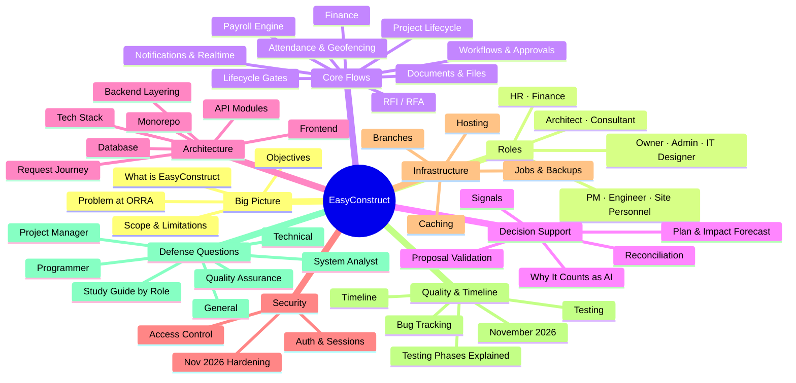

# 🏗️ EasyConstruct — Start Here

> [!summary] What this vault is
> A layered explanation of **EasyConstruct**, built from the repository (`thesis-final-staging`, 13 Nov 2026), the manuscript (Chapter 1, System Flow, Final Scope, Capstone 2 mock-defense draft) and the November 2026 project files.
> Open **[[EasyConstruct Mind Map.canvas|🧠 the Mind Map canvas]]** for the visual version, or use the **Graph view** (every note is linked).

## How each note is layered
> [!summary] 🟢 Simple — analogies, no jargon (start here)

> [!info] 🔵 Technical — how it works, rules, data, diagrams

> [!example] 🟣 Deep dive — real code from the repo and the "why"

## Learning paths
| If you want to… | Read in this order |
|---|---|
| **Explain it to anyone (5 min)** | [[What is EasyConstruct]] → [[The Problem at ORRA]] → [[Roles Overview]] → [[Project Lifecycle]] |
| **Defend the thesis** | [[Objectives]] → [[Scope and Limitations]] → [[Decision Support Overview]] → [[Architecture Overview]] → [[Testing Strategy]] → [[November 2026 Updates]] |
| **Prepare for the panel 🎤** | [[Study Guide by Role]] → [[Defense Questions Overview]] → [[General Questions]] → [[Technical Questions]] → your role's set |
| **Understand the testing** | [[Testing Phases Explained]] → [[Testing Strategy]] → [[QA Bug Tracking Nov 2026]] |
| **Understand the code** | [[Tech Stack]] → [[Monorepo Structure]] → [[Backend Layering]] → [[Request Journey]] → [[API Modules]] → [[Frontend Architecture]] → [[Database and Drizzle]] |
| **Learn the terms** | [[Glossary]] |

## The map

## All notes
**01 Big Picture** — [[What is EasyConstruct]] · [[The Problem at ORRA]] · [[Objectives]] · [[Scope and Limitations]]

**02 Roles** — [[Roles Overview]] · [[Owner]] · [[Admin]] · [[IT Designer]] · [[Project Manager]] · [[Human Resources]] · [[Finance Manager]] · [[Architect]] · [[Engineer]] · [[Site Personnel]] · [[Consultant]]

**03 Core Flows** — [[Project Lifecycle]] · [[Lifecycle Gates]] · [[Workflows and Approvals]] · [[RFI and RFA]] · [[Attendance and Geofencing]] · [[Payroll Engine]] · [[Finance Module]] · [[Documents and Files]] · [[Notifications and Realtime]]

**04 Decision Support** — [[Decision Support Overview]] · [[Why It Counts as AI]] · [[Signals]] · [[Proposal Validation and Cost Reference]] · [[Plan Suggestion and Impact Forecast]] · [[Reconciliation Checks]]

**05 Architecture** — [[Architecture Overview]] · [[Tech Stack]] · [[Monorepo Structure]] · [[Backend Layering]] · [[API Modules]] · [[Frontend Architecture]] · [[Database and Drizzle]] · [[Request Journey]]

**06 Security** — [[Authentication and Sessions]] · [[Access Control]] · [[Security Hardening Nov 2026]]

**07 Infrastructure** — [[Deployment and Hosting]] · [[Scheduled Jobs and Backups]] · [[Caching and Performance]] · [[Environments and Branches]]

**08 Quality** — [[Testing Strategy]] · [[Testing Phases Explained]] · [[QA Bug Tracking Nov 2026]]

**09 Timeline** — [[Development Timeline]] · [[November 2026 Updates]]

**10 Glossary** — [[Glossary]]

**11 Defense Questions** 🎤 — [[Study Guide by Role]] · [[Defense Questions Overview]] · [[General Questions]] · [[Technical Questions]] · [[Project Manager Questions]] · [[Programmer Questions]] · [[Quality Assurance Questions]] · [[System Analyst Questions]]

> [!warning] Things in the manuscript that differ from the code (worth updating in the paper)
> - "AI-driven" features are **rule-based and deterministic**; the System Flow paper says "external AI APIs" — the code calls no AI model ([[Decision Support Overview]]).
> - File storage is **Filebase S3**, not Vercel Blob ([[Deployment and Hosting]]).
> - Payroll **does** compute SSS/PhilHealth/Pag-IBIG employee shares, although an early limitation said government deductions were excluded ([[Payroll Engine]]).
> - Construction progress counts **tasks + live milestones**, not tasks alone ([[Project Lifecycle]]).
