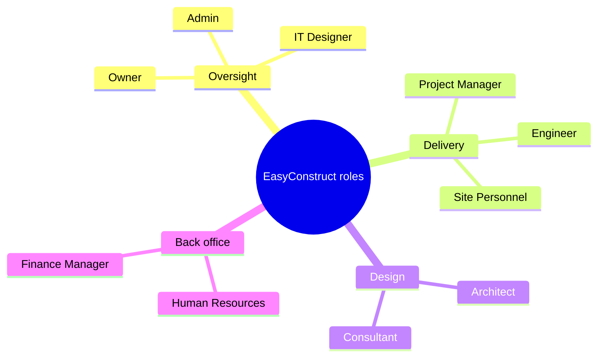

# Scope and Limitations

> [!summary] 🟢 In simple terms
> **Scope** = what the system *does* (10 roles, each with its own features). **Limitations** = what it deliberately *doesn't* do (e.g. it doesn't replace a professional's judgment, and it doesn't connect to government or bank systems).

## Scope at a glance (FINAL — ScopeLimitation.pdf)
Ten role modules. Every role has **Log In** + **Dashboard** (most with a calendar of milestones, submissions and progress).

See each role's page in [[Roles Overview]].

## Limitations
| Limitation | Meaning in practice |
|---|---|
| **Decision-support boundary** | AI/rule outputs are recommendations, validation and summaries only. Final approvals, contracts and legal decisions stay with people. In code, signals are *never* allowed to affect `canAdvance` — a test (`boundary.test.ts`) enforces it. → [[Decision Support Overview]] |
| **Payroll** | Early drafts said "basic payroll, no government deductions". The system grew: SSS, PhilHealth and Pag-IBIG employee shares are now computed from published schedules — but it is **not a certified payroll engine** (no 13th-month, de minimis, year-end annualization, and it never remits). → [[Payroll Engine]] |
| **Integration** | No real-time links to government agencies, suppliers, banks or accounting platforms. The only outside data source is a read-only construction cost reference. → [[Proposal Validation and Cost Reference]] |

## Scope changes worth knowing
- "Super Admin" (Ch. 1) became **Owner** + **IT Designer**; Admin became operational.
- Added beyond the original scope: RFI/RFA module, Design project type, procurement, owner email approvals, support requests.
- Removed: reimbursement claims, employee self-service pay page, notification email copies.

Related: [[Objectives]] · [[Development Timeline]]
