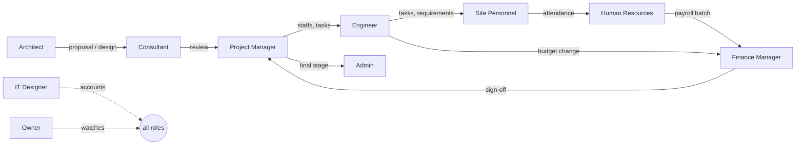

# Roles Overview

> [!summary] 🟢 In simple terms
> Everyone logs into the **same website**, but each person gets a **different sidebar and different buttons** depending on their job (their *role*). An architect never sees payroll; HR never approves a blueprint. This keeps screens simple and data safe.

## The 10 roles in 4 families
| Family | Role | One-line job | Role ID in code |
|---|---|---|---|
| 👁️ Oversight | [[Owner]] | Watches everything, changes nothing (executive, read-only) | `owner` |
| | [[Admin]] | Manages **all** projects and workflows; read-only on accounts/HR data | `admin` |
| | [[IT Designer]] | Runs the platform: accounts, roles, security, configuration | `it-designer` |
| 🏗️ Delivery | [[Project Manager]] | Owns specific projects: staffs, plans, approves, advances | `project-manager` |
| | [[Engineer]] | Requirements, progress reports, issues, milestones, budget changes | `engineer` |
| | [[Site Personnel]] | On-site: geofenced attendance, tasks, field docs, issues | `site-personnel` |
| 📐 Design | [[Architect]] | Proposals, designs, blueprints, revisions | `architect` |
| | [[Consultant]] | Reviews proposals and designs, advisory documents | `consultant` |
| 💼 Back office | [[Human Resources]] | Employees, attendance verification, payroll batches | `human-resources` |
| | [[Finance Manager]] | Budgets, expenses, procurement, payroll review | `finance-manager` |

## Who talks to whom (simplified)

## 🔵 How roles are enforced (two layers)
1. **Frontend (convenience):** `apps/web/src/config/role-resources.ts` maps each role to the pages (Refine *resources*) it may open. The Refine `accessControlProvider` hides everything else. → [[Frontend Architecture]]
2. **Backend (the real lock):** every route uses `authenticate` + `requireRole(...)`, and project data is filtered by membership for Engineer, Architect, Site Personnel and Consultant. → [[Access Control]]

> [!warning] Rule of thumb
> Hiding a button is **not** security. If the server doesn't check the role, anyone with a token could call the API directly. That's why bugs like "IT Designer can create employees" (B-78) were fixed **server-side**.

## Key role decisions made during development
- Admin = **all projects**, but read-only on accounts and employee data; doesn't see payroll.
- IT Designer = only role that changes accounts; doesn't see pay rates or attendance.
- Only the project's **own PM** approves materials/RFIs; Admin can override with a written reason (≥10 chars).
- Owner and roles outside the upload allowlist cannot create documents.
- **User Support** exists for every role and is always the last sidebar item; IT replies.
