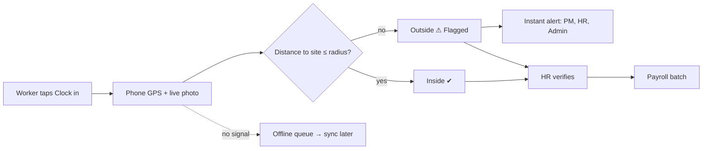

# Attendance and Geofencing

> [!summary] 🟢 In simple terms
> A **geofence** is an invisible circle around the construction site. When a worker clocks in, their phone's GPS is compared with the site's location. Inside the circle → normal. Outside → the record is **flagged** and managers are told right away. A **live camera photo** proves who clocked in.

## The flow


## 🔵 How distance is computed
The server uses the **haversine formula** (`distanceMeters()` in `attendance/service.ts`) — great-circle distance between two latitude/longitude points on a sphere.
```ts
const radius = project.geofenceRadiusM ?? 300;   // default 300 m
geofence = distanceFromSiteM <= radius ? "Inside" : "Outside";
```
- No site coordinates → status stays *Pending* (unmeasured) and never alerts.
- Only a **measured** breach (`status === "Flagged" && geofence === "Outside"`) alerts (`alert.ts`).
- Attendance is accepted only when the project is in **Construction** or **Closeout**.
- **Sheet import:** HR/Site can upload a spreadsheet; imported rows arrive as *Pending* for verification.

## 🔵 Exceptions (HR)
Configured in `core/config/attendance.ts` (all env-overridable):
| Rule | Default |
|---|---|
| Shift start | 08:00 |
| Late grace | 15 min |
| Working days | Mon–Sat |
| Absence judged after | 12:00 Manila time |
| Look-back | 7 days |

A scheduled job scans exceptions every day → [[Scheduled Jobs and Backups]]. HR sees *likely absences* with one-click **Mark absent**, plus a heatmap.

Related: [[Site Personnel]] · [[Human Resources]] · [[Payroll Engine]]
