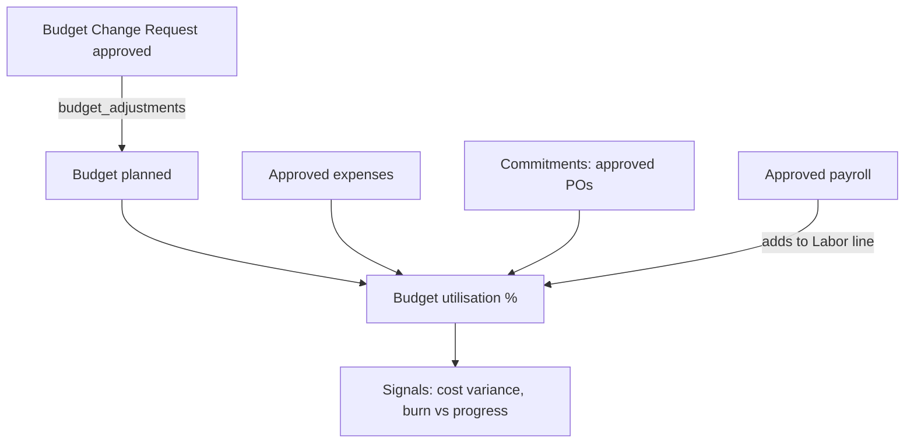

# Finance Module

> [!summary] 🟢 In simple terms
> Tracks **how much money each project is allowed to spend (budget)**, **what it actually spent (expenses)**, and **what it's about to spend (purchase requests & procurement)**. Finance approves; the system adds everything up and warns when spending runs ahead of progress.

## Sub-features (`apps/api/src/modules/finance/`)
| Folder | What it does |
|---|---|
| `budget`, `budget-adjustments`, `budget-approval-steps` | Budget lines per project, FY filter, approvals; adjustments written by approved Budget Change Requests |
| `expenses`, `categories` | Expense ledger with fixed categories; receipts; approve/reject |
| `purchase-requests`, `procurement`, `purchasing` | Request → approve → procure → deliver; unsettled procurement blocks Closeout |
| `payroll-review` | Finance side of the [[Payroll Engine]] batch review |
| `cash-flow` | Monthly in/out chart from real sources |
| `project-profitability`, `summary` | Contract value vs costs; dashboard summaries |
| `approvals` | Finance's working approval queue |

## 🔵 How the numbers connect

- Budget % and "Over budget" include **commitments** (fix B-43..45).
- **Burn vs progress** signal fires when spending % runs 20+ points ahead of task-completion % (critical at 35). → [[Signals]]
- **Reconciliation** checks that stored totals match their source records. → [[Reconciliation Checks]]

Related: [[Finance Manager]] · [[Workflows and Approvals]]
