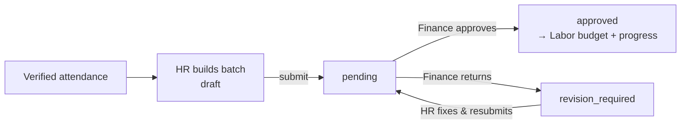

# Payroll Engine

> [!summary] 🟢 In simple terms
> Pay = **hours worked × hourly rate** (+ overtime at 1.5×). Then the system subtracts the employee's share of **SSS, PhilHealth and Pag-IBIG** using the published government tables. Nobody types the deductions — the engine computes them, so they're consistent and traceable.

## The pipeline

## 🔵 The formula (`workforce/payroll/engine.ts` → `computeLine`)
1. **Hourly rate** from the pay rate type:
   - Hourly → as is · Daily → ÷ 8 · Monthly → ÷ (22 days × 8 h)
2. **Gross** = regular h × rate + OT h × rate × **1.5** + adjustments
3. **Employee deductions** (2025 schedules):
| Agency | Base | Employee share | Employer share |
|---|---|---|---|
| **SSS** | Monthly Salary Credit: gross rounded to ₱500 bands, ₱5,000–₱35,000 | 5% | 10% + EC (₱10 / ₱30) |
| **PhilHealth** | gross clamped to ₱10,000–₱100,000 | 2.5% (half of 5%) | 2.5% |
| **Pag-IBIG** | gross capped at ₱10,000 | 1% if ≤ ₱1,500, else 2% (max ₱200) | 2% |
4. **Net** = gross − (SSS + PhilHealth + Pag-IBIG)
5. **Employer cost** = gross + employer contributions

> [!example] Worked example
> Monthly rate ₱22,000, 176 regular hours, 0 OT
> - hourly = 22,000 / 176 = **₱125**; gross = 176 × 125 = **₱22,000**
> - SSS: MSC 22,000 × 5% = **₱1,100**
> - PhilHealth: 22,000 × 5% ÷ 2 = **₱550**
> - Pag-IBIG: min(22,000, 10,000) × 2% = **₱200**
> - **Net = 22,000 − 1,850 = ₱20,150**

## 🔵 Safety features
- Every line stores the **rate-version IDs** used (`builtin-sss-2025`…) → you can always explain old payslips.
- **Calculation trace drawer** shows each step.
- **Pre-submit warnings** (never blocking, HR acknowledges): > 12 h/day, overtime > 50% of hours, rate > 25% away from position median (needs ≥ 3 peers). Thresholds in `core/config/payroll.ts`, env-overridable.
- Gate **X3** needs a Closeout payroll batch approved. → [[Lifecycle Gates]]

## ⚠️ Honest limits
- Not a certified payroll engine: no 13th-month pay, de minimis benefits, withholding tax, year-end annualization; it **never remits** to agencies.
- Rates are constants in code. Open item (#9 of the 12 Nov review): move them to a dated **rates table**. → [[Security Hardening Nov 2026]]

Related: [[Human Resources]] · [[Finance Manager]] · [[Attendance and Geofencing]]
