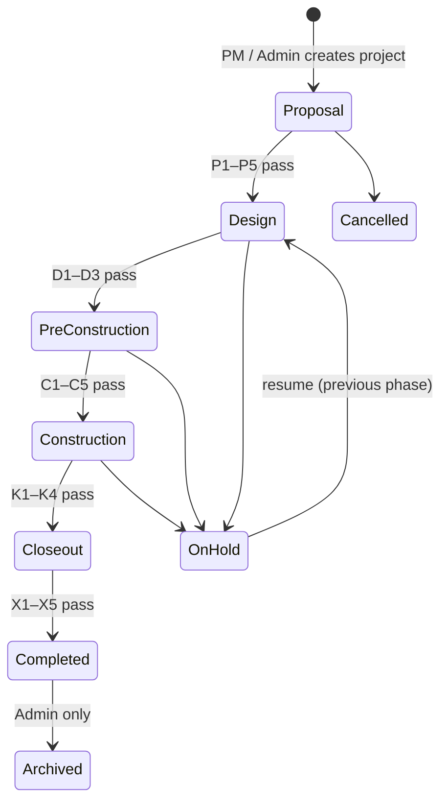

# Project Lifecycle

> [!summary] 🟢 In simple terms
> Every project travels through **fixed phases**, like grades in school: you can only move up when you've passed the requirements of your current grade. The progress bar (0–100%) is **calculated by the system**, never typed by a person.

## The phases


| Phase | Plain meaning | Progress band |
|---|---|---|
| **Proposal** | Winning the job: team, proposal, award, contract | 0 → 10% |
| **Design** | Drawings and approvals | 10 → 25% |
| **Pre-Construction** | Materials, budget, schedule, crew, permit to proceed | 25 → 30% |
| **Construction** | Building it | 30 → 95% |
| **Closeout** | Final inspection, certificate, final payroll | 95 → 99% |
| **Completed / Archived** | Done / stored away | 100% |
| **On Hold / Cancelled** | Paused / stopped | frozen |

## Two delivery types
- **Construction** — the full path above.
- **Design** (plans-only job: architectural, structural, interior…) — `Proposal → Design → Turnover → Completed → Archived`. Design progress is the **average of plan-set points** (not_started 0, in_progress 40, for_review 70, approved 90, issued 100) inside a 10→90 band; Turnover is 90→99.

## 🔵 How progress is calculated
- Gate-based phases: progress = band start + (share of gate checks passed × band width).
- **Construction:** `30 + 65 × done / total`, where units = **tasks + live milestones** (active, at-risk, completed). Draft/cancelled milestones don't count; 0 units → 30.
- Only one function writes `projects.progress`: `refreshProjectProgress`. It's called after writes in ~20 modules (tasks, milestones, attendance, payroll, designs…).

## 🔵 Rules enforced by the server (`lifecycle/service.ts`)
| Action | Who | Rule |
|---|---|---|
| **Advance** | Project's own PM or Admin | Blocked → **HTTP 409 with the list of failing checks**. Admin override needs reason ≥ 10 chars, stored in `project_phase_history` + audit log |
| **Hold / Resume** | PM or Admin | Only from Design, Pre-Construction, Construction; reason required; resume returns to the saved phase |
| **Cancel** | PM/Admin in Proposal; Admin only later | Reason required |
| **Archive** | Admin only | Only from Completed |
| **Write lock** | — | `assertProjectWritable` returns 409 for writes in Archived, Cancelled, On Hold |
| **Lifecycle fields** | — | `PATCH /projects/:id` **rejects** `status`, `progress`, `statusTone`; use `/lifecycle/advance` etc. |

## 🟣 Deep dive: where it lives
```
apps/api/src/modules/projects/lifecycle/
├── phases.ts        ← single source of truth: phase list, bands, NEXT_PHASE, tones
├── gates.ts         ← every check as a PURE function over a snapshot (no DB)
├── delivery.ts      ← Construction vs Design path
├── approval-authority.ts ← "only this project's PM, or Admin with a reason"
├── repository.ts    ← loadSnapshot(): reads everything the gates need
├── service.ts       ← advance/hold/resume/cancel/archive + progress
├── my-actions.ts    ← "Waiting on you" card (checks whose ownerRoles include you)
└── *.test.ts        ← gates, progress, boundary, delivery tests
```
> [!tip] Why "pure functions over a snapshot"?
> `gates.ts` never touches the database. The repository loads a `LifecycleSnapshot` once, and each check is just `(snapshot) => { passed, detail }`. That makes every gate **unit-testable with a hand-built object** — no database needed. See [[Testing Strategy]].

Next: [[Lifecycle Gates]] (the full checklist) · [[Workflows and Approvals]]
