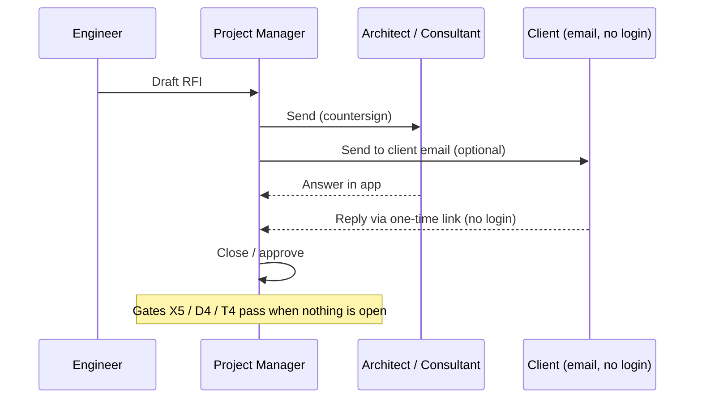

# RFI and RFA

> [!summary] 🟢 In simple terms
> **RFI = Request for Information** ("This drawing is unclear — what size is this beam?"). **RFA = Request for Approval** ("Can we use this alternative material?"). The PM or Engineer asks; the Architect, Consultant — or even the **client by email** — answers. A project **cannot be closed** while any request is still open.

## Flow


## 🔵 Rules
- Number format: `{KIND}-{PROJECT}-{DISC}-{SEQ:3}-{YY}` (e.g. `RFI-PRJ01-ARC-004-26`).
- Default due: **3 days** (RFI), **4 days** (RFA). *Overdue* is **derived**, never stored.
- **Open** = `draft`, `open`, `in_review`. Closed = `answered`, `approved`, `approved_as_noted`, `rejected`, `closed`.
- One request can go to **several stakeholders**.
- Only the project's own PM sends; Admin can override with a reason.
- Printable form with letterhead; **transmittals** record what documents were sent to whom.
- Pending decision (N-4 option B): follow-ups become **history entries** inside the original request instead of new numbered copies (needs a new `design_request_updates` table).

## 🟣 The no-login reply link (security)
```
design-requests/
├── reply-tokens.ts        ← random token; only its SHA-256 hash is stored
├── public-reply-routes.ts ← the only unauthenticated write route
├── client-email.ts        ← outbound email to the client
└── scheduler.ts           ← hourly overdue sweep
```
- The emailed link carries a random token; the DB stores only `sha256(token)` → a database leak doesn't leak working links.
- Malformed tokens are rejected **before** files are read; attachments limited (default 5 × 4 MB) so one anonymous request can't exhaust memory (security fix #12, Nov 12).
- Email is **outbound only**: the system doesn't read Gmail replies; the sender updates status manually.

Related: [[Lifecycle Gates]] · [[Scheduled Jobs and Backups]]
