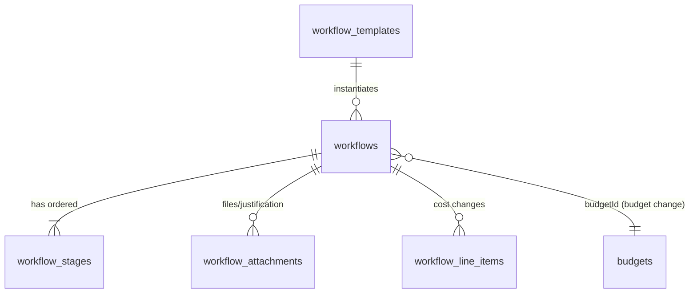

# Workflows and Approvals

> [!summary] 🟢 In simple terms
> A **workflow** is a document that has to be **signed by several people in order** — like a permission slip that goes from teacher → principal → parent. Each stage belongs to one role. If anyone rejects it, it stops (or goes back for revision).

## The templates (seeded)
| Template | Stage order | Used for |
|---|---|---|
| **Design Proposal Approval** | Architect → Consultant → PM | Gates P3/P4 |
| **Budget Change Request** | Engineer → Finance → PM → Admin | Final approval updates `budgets.planned` + writes `budget_adjustments` |
| **Change Order Request** | PM → Engineer → Finance → Admin | Scope/schedule change; can start from an RFI/RFA with cost/time impact; PM/Admin only |
| **Project Closeout** | Engineer → Finance → PM → Admin | Gate X4; only in Closeout, one at a time |
| **Design Turnover** | Architect → Consultant → PM → Admin | Gate T3 (Design projects) |
| **Subcontractor onboarding** | HR → PM → Admin | HR verifies docs |
| **Public works compliance** | Architect → PM → Finance → Admin | Public-sector projects |
| **Document Compliance Review** | Consultant → Architect → Admin | Advisory document flagged |

Any **active** workflow blocks gate **K4** (can't leave Construction with open approvals).

## 🔵 Data model

- `workflow_templates.default_stages` is **JSON** (`{ role, roleLabel, iconKey }[]`) — copied into `workflow_stages` rows when a workflow starts.
- Each stage: `sequence`, `role`, `status` (`upcoming` → current → approved/rejected), `decidedBy`, `decidedAt`, `comments`.
- The **initiator's stage is auto-approved**, so the next stage becomes current immediately.
- `createdByUserId` lets the system notify the initiator on the final outcome.
- Line items (materials/labour/other: current vs requested amount) carry a **validation** summary when the AI flag is on → [[Proposal Validation and Cost Reference]]

## 🔵 Extra behaviour
- **Bulk approve** in the approval queue.
- **Stalled stage** signal if a stage waits > 48 h (critical > 120 h) → [[Signals]]
- **Impact forecast** shown to approvers of cost changes → [[Plan Suggestion and Impact Forecast]]
- Admin configures templates and the approval hierarchy (Workflow Configuration page).

Related: [[Lifecycle Gates]] · [[Finance Manager]]
