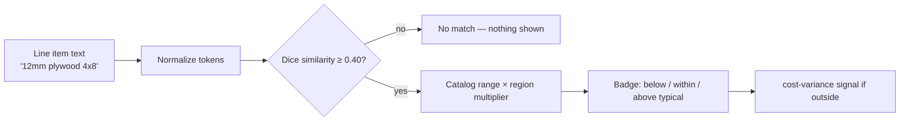

# Proposal Validation and Cost Reference

> [!summary] 🟢 In simple terms
> When an architect submits a proposal, the system **compares it with similar past proposals** and **checks for duplicates**, then shows reviewers a short "things to look at" list. For cost line items, it looks up a **public construction price catalog** to say whether a price looks typical, high or low.

## 🔵 Proposal checks (`design/proposals/validation.ts`)
Deterministic, runs on every submission, stored in the `aiValidation` column, **never changes the proposal's status**.
| Check | Rule (from `PROPOSAL_CHECKS`) |
|---|---|
| Amount too high / low | vs **median** of ≥ 3 past proposals of the same project type: > 2× or < 0.4× |
| Possible duplicate | title similarity ≥ 0.7 **and** amount within 10% **and** filed within 30 days |
| Completeness / context | vs the contract, other proposals on the same project, what that project type normally covers |
Every warning names its **basis** (the sample it used). A "Failed validation" card and a compact Validation column appear in the UI.

## 🔵 Cost catalog matching (`insights/ai-validation/`)

- **Dice coefficient** = `2 × |A ∩ B| / (|A| + |B|)` over word tokens. Keeps meaningful tokens like `12mm`, `4x8`; drops stopwords.
- Source: **EstimationPro.ai** (free, no key) — the only outbound integration. `reference-client.ts` never throws; a failure just means "use cache".
- Cached in `reference_snapshots` for **7 days**; daily request budget **80** (provider limit 100/day).
- IT Designer has an **AI Validation Reference** page to inspect the catalog.

> [!update] Extended to Procurement — 19 Nov
> A submitted **Purchase Request**'s line items now get the same catalog check as Budget Change Request / Change Order Request lines: same matcher, same `reference_snapshots`, same `ReferenceBasisBadge` — shown on the Purchase Request detail panel. Both parent types share one `validation_results` table, keyed to **either** a workflow line item **or** a Purchase Request line item (exactly one parent per row, enforced by a DB constraint). Purchase *Orders* are **not** wired in yet — Requests only. This is separate from `material_price_references`, the offline demo-pricing table Procurement also has; that one doesn't feed this matcher.

> [!tip] Explaining Dice in one line
> "plywood 12mm 4x8" vs "12mm marine plywood" share 2 tokens → 2×2 / (3+3) = **0.67** → match.

Related: [[Decision Support Overview]] · [[Architect]] · [[Consultant]]
