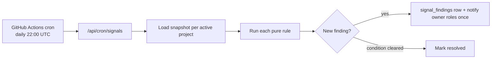

# Signals (issue detection)

> [!summary] 🟢 In simple terms
> Signals are **smoke detectors** for projects. A scheduled job looks at every active project and raises a warning (yellow) or critical (red) flag when a number crosses a threshold — e.g. "spending is way ahead of work done". Each flag comes with **one plain-language suggested action** (the *playbook*).

## The rules and thresholds (`core/config/signals.ts`)
| Rule | Fires when… | ⚠ Warn | 🔴 Critical |
|---|---|---|---|
| `cost-variance` | A line item's price is above/below the typical catalog range | 15% | 30% |
| `cumulative-change-impact` | Approved changes add up vs contract | 10% | 20% |
| `burn-vs-progress` | Spend % minus task-completion % | 20 pts | 35 pts |
| `issue-recurrence` | Same kind of issue repeats within 30 days | 3 | 5 |
| `stalled-stage` | A workflow stage waits for a decision | 48 h | 120 h |
| `projected-finish` | Pace over last 28 days projects a finish past the last milestone | 7 days | 21 days |
| `overdue-tasks` | Open tasks past due date | 3 | 8 |
| `milestone-slip` | Active/at-risk milestone past its date | 1 day | 14 days |
| `issue-precedent` | A similar issue was resolved before (Dice ≥ 0.40) | info | — |

## The playbook (examples from `signals/playbook.ts`)
- **burn-vs-progress** → "Compare spending with the work actually done… agree a corrective plan with Finance."
- **stalled-stage** → "Contact the person who owns the waiting approval stage, or ask Admin to reassign it."
- **issue-precedent** → "Read its resolution notes and reuse what worked."

## 🔵 How a scan works (`signals/scan.ts`)

- Each rule is a **pure function** over a snapshot (no DB access) → easy unit tests.
- Findings stored once per occurrence (no notification spam) and **auto-resolve** when the condition clears.
- Never changes a project, a gate or an approval.

Related: [[Decision Support Overview]] · [[Scheduled Jobs and Backups]] · [[Finance Module]]
