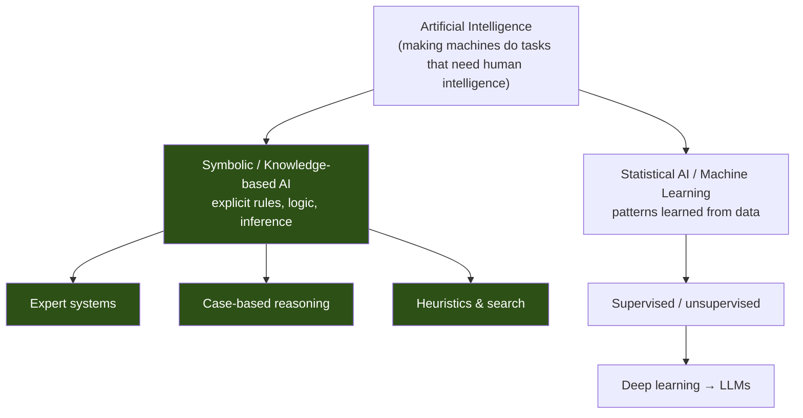

# Why the Decision Support Counts as "AI-Driven"

> [!summary] 🟢 The short version
> AI is not only machine learning. **Rule-based and knowledge-based reasoning is one of the oldest and most established branches of artificial intelligence** — it is what the entire field was built on before statistical learning became dominant. EasyConstruct's decision support uses several recognized AI techniques. It is defensible to call it AI-driven, as long as you are precise about *which kind* of AI and never imply machine learning.

> [!warning] Separate two questions the panel will blur together
> **Q1: "Is rule-based reasoning really AI?"** → **Yes.** Defend this confidently; the argument is below.
> **Q2: "Does your system call external AI APIs, as the System Flow paper says?"** → **No, and that line in the paper should be corrected.** This is a factual wording error, not an argument to win. Concede it immediately and move on.
> Losing Q2 is survivable. Conceding Q1 when you didn't have to is throwing away a whole objective.

---

## 🔵 The AI family tree

**Green = where EasyConstruct lives.** The left branch is not a lesser imitation of the right one; it is the older sibling. Expert systems such as MYCIN and DENDRAL were landmark AI systems in the 1970s and 80s, and they were entirely rule-based — no learning involved.

> [!tip] Sources to name if the panel wants authority
> - **Russell & Norvig**, *Artificial Intelligence: A Modern Approach* — the standard AI textbook; devotes major sections to knowledge-based agents, logical inference and rule-based reasoning as core AI, long before the chapters on learning.
> - **Turban et al.**, *Decision Support and Business Intelligence Systems* — the standard DSS text; treats rule-based expert systems as the classic form of **intelligent decision support**.
> Naming a textbook converts your answer from opinion into citation. If you name them, be ready to say what they cover — don't quote page numbers you haven't read.

---

## 🔵 Which AI techniques EasyConstruct actually uses
This table is the strongest single artifact in your defense of the AI claim. Each row names a **recognized technique**, not a marketing word.

| Feature in EasyConstruct | Recognized AI technique | Why it qualifies |
|---|---|---|
| **Signals** — 8 threshold rules with warn/critical levels and a suggested action for each | **Rule-based expert system** (production rules + knowledge base) | Encodes a domain expert's judgment as explicit `IF condition THEN conclusion + recommended action` rules — the textbook definition of an expert system. → [[Signals]] |
| **Issue precedent** — "a similar issue was resolved before" | **Case-based reasoning (CBR)** | A classic AI paradigm: solve a new problem by retrieving the most similar past case and reusing its solution. Retrieval uses Dice similarity ≥ 0.40. → [[Signals]] |
| **Proposal validation** — median × 2 / × 0.4 outlier detection, duplicate detection | **Heuristic / statistical anomaly detection** | Heuristics are a foundational AI method for judgment under uncertainty when exhaustive evaluation is impossible. → [[Proposal Validation and Cost Reference]] |
| **Cost reference matching** — line items matched to a catalog | **Similarity-based matching / information retrieval** | Dice coefficient string similarity is a standard IR and NLP technique. → [[Proposal Validation and Cost Reference]] |
| **Requirement structuring** — splits a rough note into Objectives / Materials / Constraints / Specifications, flags vague phrases | **Rule-based natural language processing** | Clause segmentation and classification by linguistic rules is NLP's original, pre-statistical form. → [[Decision Support Overview]] |
| **Plan suggestion** — drafts milestones, tasks and responsibilities from project type + start date | **Knowledge-based planning (template/case-based)** | Automated planning is a core AI subfield; ours is template-driven rather than search-based. → [[Plan Suggestion and Impact Forecast]] |
| **Impact forecast** — projected cost, estimate at completion, schedule slip | **Model-based prediction / what-if reasoning** | Reasoning forward from a model of the domain to predict consequences of an action. → [[Plan Suggestion and Impact Forecast]] |

> [!important] Say the number
> That's **seven distinct decision-support capabilities spanning five recognized AI technique families** — expert systems, case-based reasoning, heuristic anomaly detection, rule-based NLP, and knowledge-based planning. "Just if-else statements" does not describe that honestly.

---

## 🔵 Why this kind of AI was the *right* choice here (not a fallback)
This is the part that turns a defensive answer into a confident one. Four arguments, strongest first:

1. **Explainability is a requirement, not a nice-to-have.** A PM must justify to an owner why a proposal was flagged. Our system answers: *"this exceeds twice the median of five past Residential proposals."* A neural model's answer — *"the model scored it 0.83"* — would be unusable in a construction approval chain and arguably unethical as the basis for rejecting a contractor's bid.
2. **There is no training data.** ORRA's historical records are on paper and number in the dozens, not the thousands. Machine learning on that volume produces confident nonsense. **Choosing not to use ML here is the correct engineering judgment**, and saying so demonstrates you understand ML rather than that you avoided it.
3. **Determinism makes it testable — and therefore defensible as a thesis.** Same input, same output, every time. That's why the signal rules, the matcher and the structuring function all have unit tests. A probabilistic model could not be verified this way within a capstone's scope. → [[Testing Strategy]]
4. **It respects our own stated boundary.** The scope says decision *support*: advise, validate, summarize — never decide. Rules make that boundary enforceable in code, and `boundary.test.ts` fails the build if advice ever reaches `canAdvance`. → [[Scope and Limitations]]

---

## 🔵 What it is NOT — say this before you're asked
Volunteering the limits is what separates a researcher from a salesperson.

- ❌ **Not machine learning.** Nothing is trained; no model weights exist.
- ❌ **Not a large language model.** No LLM is called anywhere in the codebase.
- ❌ **Not calling any external AI service.** The only outside data source is a read-only construction cost reference catalog.
- ❌ **Not adaptive.** It does not get smarter from use. It does, however, **record whether advice was shown, taken or dismissed** — which is the groundwork for learning later, and good Chapter 5 material. → [[Decision Support Overview]]
- ❌ **Not autonomous.** It cannot approve, reject, advance or modify anything.

---

## 🟣 The scripted answer
> [!example] When asked: *"Isn't this just if-else? How is it AI?"*
> *"It's rule-based AI — the symbolic branch of the field rather than machine learning. Concretely, the signals module is a rule-based expert system: eight production rules encoding domain thresholds, each producing a conclusion and a recommended action. Issue precedents use case-based reasoning — retrieving the most similar past case by Dice similarity and reusing its resolution. Proposal validation is heuristic anomaly detection against the median of comparable past projects, and requirement structuring is rule-based NLP.*
> *We chose symbolic over statistical deliberately. Our client has dozens of historical records, not thousands, so there's nothing to train on — and more importantly, every output must be explainable, because a Project Manager has to justify a flag to an owner. 'Twice the median of five comparable proposals' can be defended in a meeting; a model score cannot. It also keeps us inside our own scope boundary: the system advises, people decide, and we enforce that with a test that fails the build if advice ever reaches the gate logic.*
> *To be precise about one thing: we don't call any external AI API, and where the System Flow document says we do, that wording is wrong and we'd correct it."*

> [!tip] Delivery notes
> - Lead with the **technique name**, not with a defence. "It's rule-based AI" beats "well, it's not really AI, but…"
> - **Name one specific number** in the first thirty seconds (eight rules, Dice ≥ 0.40, median × 2). Specificity reads as competence.
> - **Volunteer the ML limitation yourself.** If the panel extracts it from you, it's a weakness; if you offer it, it's rigor.
> - If asked *"so could you add real AI later?"* → yes, and you already log advice outcomes, which is exactly the labeled data a future model would need.

---

## 🟣 What to fix in the manuscript
| Where | Current | Should be |
|---|---|---|
| System Flow paper | implies **external AI APIs** | rule-based / knowledge-based decision support, computed in-system |
| General "AI-driven" usage | unqualified | **"AI-driven (rule-based decision support)"** on first use, then consistent |
| Objective 3 | "AI-driven project intelligence" | keep the objective, define the mechanism once in Chapter 3 so the panel never has to ask |

Defining the term yourself, early, in your own words is the cheapest possible insurance: a panel that reads your definition in Chapter 3 rarely attacks it in the defense.

Related: [[Decision Support Overview]] · [[Signals]] · [[Proposal Validation and Cost Reference]] · [[Plan Suggestion and Impact Forecast]] · [[General Questions]]
