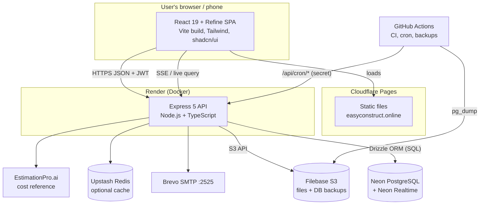

# Architecture Overview

> [!summary] 🟢 In simple terms (restaurant analogy 🍽️)
> - **Frontend (React)** = the **dining room and menu**. What users see and click.
> - **Backend API (Express)** = the **waiter + kitchen**. Takes orders (requests), checks you're allowed to order it, cooks (business rules), returns the dish (JSON).
> - **Database (PostgreSQL on Neon)** = the **pantry**. Where all ingredients (data) are stored in labelled shelves (tables).
> - **Object storage (Filebase S3)** = the **warehouse** for big items (files, photos, blueprints).
> - **Email (Brevo)** & **cron (GitHub Actions)** = the **delivery driver** and the **alarm clock** for daily chores.

## The big diagram

## Architectural style in one table
| Concern | Choice | Note |
|---|---|---|
| App type | **SPA** (single-page app) + **REST API** | [[Request Journey]] |
| Repo layout | **Modular monorepo** (npm workspaces) | [[Monorepo Structure]] |
| Backend pattern | **Layered**: routes → controller → service → repository | [[Backend Layering]] |
| Backend modules | 9 feature modules with a manifest, mounted from a registry | [[API Modules]] |
| Frontend pattern | Feature folders: repository → service → controller → hook → page | [[Frontend Architecture]] |
| Data | PostgreSQL + Drizzle ORM, SQL migrations | [[Database and Drizzle]] |
| Auth | JWT bearer tokens + bcrypt + role guards | [[Authentication and Sessions]] |
| Hosting | Free-tier cloud, no credit card | [[Deployment and Hosting]] |

Why "PERN"? **P**ostgreSQL · **E**xpress · **R**eact · **N**ode — all JavaScript/TypeScript end to end, so one language and shared types across frontend and backend. → [[Tech Stack]]
