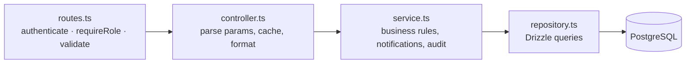

# Backend Layering

> [!summary] 🟢 In simple terms
> Each request passes through **4 desks**, each with one job:
> 1. **Routes** – the door: which URL, who's allowed in, is the form filled correctly?
> 2. **Controller** – the receptionist: reads the request, calls the right service, formats the reply.
> 3. **Service** – the expert: business rules ("only the project's PM may approve").
> 4. **Repository** – the librarian: the only one who talks to the database.



## 🔵 A real example: creating a project
**routes.ts** — the guard chain (middleware run left to right):
```ts
router.use(authenticate);                       // 1. valid JWT?
router.post('/',
  requireRole("project-manager", "admin"),      // 2. right role?
  validate(createProjectSchema),                // 3. body matches Zod schema?
  controller.create,                            // 4. go
);
router.patch('/:id',
  requireRole("project-manager", "admin"),
  rejectLifecycleFields,  // refuses status/progress → must use /lifecycle/advance
  validate(updateProjectSchema),
  controller.update,
);
```
**controller.ts** — reads filters, applies caching, wraps the reply:
```ts
const result = shared
  ? await cached("projects", shared, 60, load, { query: req.query }) // 60 s cache
  : await load();
res.json(formatSuccess(result.items, MSG.projects.retrieved));
// → { success: true, message: "...", data: [...] }
```
**service.ts** — rules, visibility scope (a PM sees only own projects; Consultant gets commercial fields stripped), audit log, notifications.
**repository.ts** — Drizzle query builder, e.g. `db.select().from(projects).where(eq(projects.code, code))`.

## 🔵 Shared building blocks in `core/`
| File | Role |
|---|---|
| `http/validate.ts` | `validate(schema)` / `validateQuery(schema)` using Zod `safeParse` → 400 on failure |
| `http/error.ts` | One error middleware: `AppError` → status + code; malformed JSON → 400; too large → 413; Postgres errors mapped (`pg-errors.ts`) |
| `utils/response.ts` | `formatSuccess(data, message)` — the `{ success, message, data }` envelope |
| `utils/pagination.ts` | `parsePageRequest`, `sendPaged` (page, limit, sort, meta) |
| `audit/audit.ts` | `logAudit(...)` for traceable actions |
| `utils/diff-fields.ts` | "what changed" lines for edit audits |

## 🟣 Why layers? (defense answer)
- **Testability:** pure rules (gates, signals, payroll engine) live in files with *no I/O*, so they're tested without a database.
- **Single responsibility:** a bug in SQL is in a repository; a bug in "who may approve" is in a service.
- **Security in depth:** role checks at the route **and** ownership checks in the service.

Related: [[Request Journey]] · [[API Modules]] · [[Access Control]]
