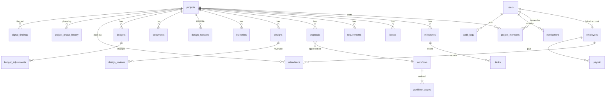

# Database and Drizzle

> [!summary] 🟢 In simple terms
> All data lives in **PostgreSQL**, organized into **tables** (like Excel sheets with strict columns). **Drizzle ORM** lets the code describe those tables in TypeScript and write queries that are checked by the compiler. **Migrations** are numbered SQL scripts that change the database step by step, like save points in a game.

## 🔵 Key entities (simplified ERD)

~44 schema files in `apps/api/src/core/db/schema/` (projects, tasks, milestones, workflows, payroll, attendance, documents, stored-files, signal-findings, owner-action-requests, support-requests…).

## 🔵 What a table looks like in Drizzle
```ts
export const projects = pgTable('projects', {
  id:            serial('id').primaryKey(),
  code:          varchar('code', { length: 50 }).notNull().unique(), // human ID e.g. DEMO-STAGE-3
  progress:      integer('progress').notNull().default(0),           // written only by lifecycle
  contractValue: numeric('contract_value', { precision: 14, scale: 2 }),
  clientId:      integer('client_id').references(() => clients.id),  // foreign key
  // siteLatitude, siteLongitude, geofenceRadiusM, deliveryType, pmUserId ...
});
```
- `numeric(14,2)` for money (never floating-point).
- Projects have a numeric `id` **and** a human `code`; the UI links by code (`/projects/DEMO-STAGE-3`).

## 🔵 Migrations
- 47 SQL files in `apps/api/drizzle/` (`0000_…` → `0046_catch_up_schema.sql`) + `meta/_journal.json`.
- `npm run db:generate` (Drizzle Kit diffs the TS schema → SQL) · `npm run db:migrate` applies pending ones **by hash**, supports `--dry-run`, refuses an un-baselined database.
- `db:verify-schema` compares the live DB with the expected schema.
- The API **does not** migrate on startup; migrations are a separate deploy step, run against Neon's **direct** (non-pooled) URL.

## 🔵 Connection
- `pg` Pool, default **5** connections (`DB_POOL_MAX`), idle clients released after 10 s — sized for Neon's pooled endpoint.
- Neon gives **branches** (copy-on-write database copies) — used for staging experiments.
- Production DB host: `ep-fancy-king-…` (QA tooling refuses to run against it).

Related: [[Backend Layering]] · [[Reconciliation Checks]] · [[Deployment and Hosting]]
