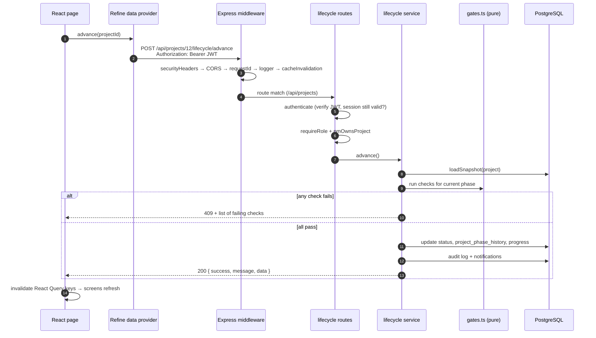

# Request Journey — what happens when you click a button

> [!summary] 🟢 In simple terms
> Clicking **"Advance phase"** sends a small message to the server. The server checks *who you are*, *whether you're allowed*, *whether the project is ready*, saves the change, tells the right people, and sends back the answer. The screen then updates.

## Step by step: PM clicks "Advance" on project DEMO-STAGE-2

## 🔵 The middleware chain (order matters, from `app.ts`)
1. `express.json` (12 MB only for `/api/uploads`, 2 MB elsewhere)
2. `securityHeaders` (no `x-powered-by`)
3. `/api/health` and `/api/health/ready` (before auth — for uptime checks)
4. `corsMiddleware` (exactly one allowed origin)
5. `requestId` + `logger` (trace each request)
6. `cacheInvalidation` (after a successful write, bump cache versions *before* replying)
7. All module routers (in registry order)
8. `errorMiddleware` (turns thrown errors into JSON with the right status)

## 🔵 Status codes you'll see
| Code | Meaning in EasyConstruct |
|---|---|
| 200/201 | OK / created |
| 400 | Validation failed (Zod) or malformed JSON |
| 401 | Missing/expired token, signed out, deactivated |
| 403 | Wrong role or not your project; Admin override without a reason |
| 404 | Not found (or not visible to you) |
| 409 | Business rule blocks it: gate failing, project write-locked |
| 413 | Upload too large |
| 503 | Feature not configured (email, Realtime) |

Related: [[Backend Layering]] · [[Authentication and Sessions]] · [[Project Lifecycle]]
