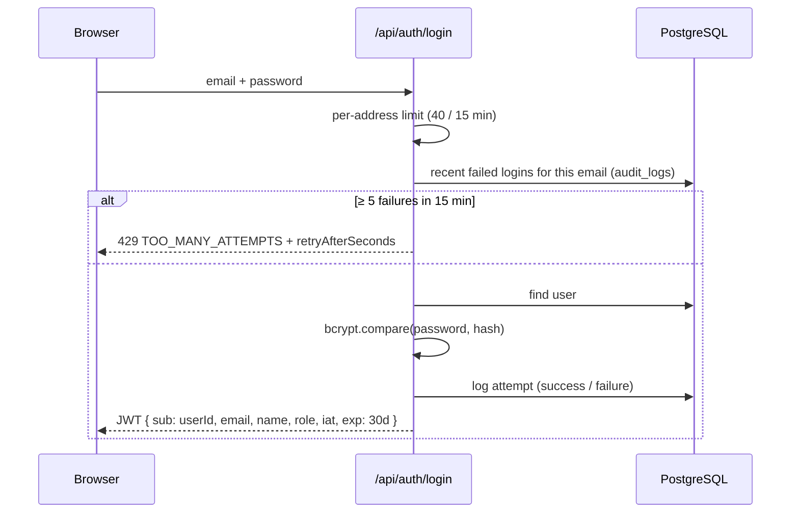

# Authentication and Sessions

> [!summary] 🟢 In simple terms
> When you log in, the server checks your password and gives you a **signed digital pass (JWT)**. Your browser shows that pass with every request. The server can verify the signature without looking anything up — but it also double-checks that you haven't been **deactivated, signed out, or had your password or role changed** since the pass was issued.

## 🔵 Login flow

## 🔵 What's inside a JWT?
Three base64 parts: `header.payload.signature`. The payload holds `sub` (user id), `email`, `name`, `role`, `iat` (issued at), `exp`. The **signature** is made with `JWT_SECRET`; anyone can *read* a JWT, but nobody can *change* it without the secret.

## 🔵 Every request: `authenticate` middleware (`core/auth/middleware.ts`)
1. Read `Authorization: Bearer <token>` (or `?token=` **only** on the SSE stream route).
2. `jwt.verify(token, JWT_SECRET)` → reject if invalid/expired.
3. Look up session state (cached **15 s** per user): account exists? `is_active`? `password_changed_at` / `sessions_valid_after`?
4. If the token's `iat` is **before** the latest cutoff → *"Session expired — please sign in again"*.
5. Attach `req.authUser = { id, email, name, role }`.

**Things that end all existing sessions:** password change · IT Designer reset · deactivation · explicit server-side sign-out · **role change** (since 12 Nov).

## 🔵 Passwords
- Stored as **bcrypt** hashes, cost 10 (a hash is one-way; even admins can't read passwords).
- Minimum 10 characters; reset-link passwords also need an uppercase letter and a digit.
- **Reset links:** 256-bit random token, only its SHA-256 stored, single use, valid 30 minutes, rate-limited like login (since 12 Nov).
- **Owner fail-safe recovery** by email if the IT Designer account is lost.

## ⚠️ Known trade-offs
- 30-day tokens are long for payroll data; recommended: 12 h–7 d + refresh token (not done to avoid sign-outs).
- Someone who knows an email can trigger a 15-minute lockout by failing on purpose (visible in audit trail).
- No MFA / CAPTCHA (out of scope).

Related: [[Access Control]] · [[Security Hardening Nov 2026]]
