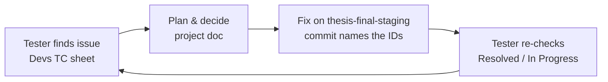

# QA Bug Tracking (Nov 2026)

> [!summary] 🟢 In simple terms
> Testers log every problem with an ID (**B-xx** for bugs, **N-x** for new findings), a severity and the page. Developers fix them in batches, testers re-check, and the sheet versions (**TC_2**, **TC_3**) show progress.

## The cycle

Commit messages reference IDs so every fix is traceable, e.g. `fix(designs): delete works with review requests… (B-150, B-151)`.

## TC_2 → TC_3 highlights (7–12 Nov)
| Theme | Examples |
|---|---|
| Access & guards | B-1..3, B-69/70, B-220 route guards; B-128/183 Site Reports hidden from HR/Finance, Site Personnel gets Projects page; B-78 IT can't create employees |
| Wrong numbers | B-43..45 budget % includes commitments; approvals count only active workflows |
| Workflow / design | B-211 revision re-queues Consultant review; N-5 only PM/Admin raise change orders; B-150/151 design delete & In Review |
| UI consistency | B-24/170 Requests table = Projects table; B-26 focus ring; outline buttons for Reject/Cancel; pagination on daily attendance (B-103) |
| Forms | B-90 column headings; B-172 Measurements & Observations on engineering reports; N-1/N-2 FY filter |

## Still open (as of 11 Nov)
| ID | Issue | Status |
|---|---|---|
| **N-4** (+ B-25/B-171) | RFI follow-ups create copies; no reply box | Decision **B**: follow-ups become history entries in one request; needs new table + migration (~1 day) |
| B-89 | PM sees tasks from other projects | Not reproducible from code; need exact account |
| B-125 | Expense export opens as raw CSV | Proposed `.xlsx` export (needs a library approval) |
| B-88 | Long file names overlap | Re-test after deploy |

Related: [[Testing Strategy]] · [[November 2026 Updates]]
