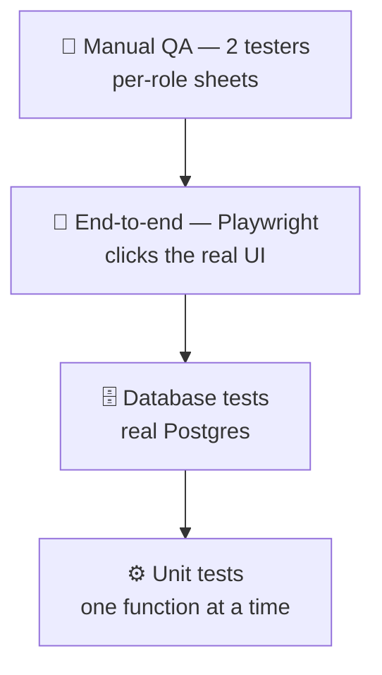
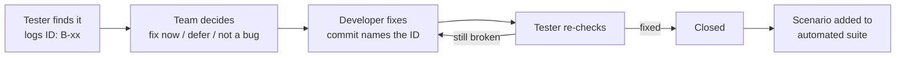

# Testing Phases — Explained for the Whole Group

> [!summary] 🟢 Read this if testing isn't your role
> [[Testing Strategy]] tells you *what we did*. This note explains *what the words mean* and *why each phase exists*, so any member can answer a testing question without being the QA person.

## First: two different things share the word "testing"
A lot of confusion in defenses comes from mixing these up. They are **not** the same list.

| | **Test levels** (the pyramid) | **Test phases** (the manuscript) |
|---|---|---|
| Answers | *How deep into the code is this test?* | *What stage of the project are we in?* |
| Example | Unit, DB, End-to-end, Manual | Unit → Integration → Alpha → Beta → Field |
| Changes over time? | No — all levels run forever | Yes — you move through them once |
| Who cares | Developers | Panel, client, manuscript |

> [!tip] One-line distinction to memorize
> **Levels** = how a test is built. **Phases** = when in the project it happens. Chapter 4 describes phases; the repository contains levels.

---

## Part 1 — The test levels (the pyramid)

Read it bottom-up: **many cheap fast tests at the bottom, few slow expensive ones at the top.**

### ⚙️ Unit test — "does this one formula give the right answer?"
> [!example] Analogy
> Testing a single calculator button. You press `7 × 8`, you expect `56`. You don't care whether the calculator has a nice case.

- Tests **one pure function** with hand-made inputs. No database, no browser, no internet.
- Runs in milliseconds, so we can run **1,090 of them** on every save.
- In EasyConstruct: gate checks (`gates.test.ts`), the payroll engine (`engine.test.ts`), signal rules, the duplicate-proposal matcher, password throttling.
- **Why it's the biggest layer:** a failure points at exactly one function, so you know immediately where the bug is.

### 🗄️ Database test — "does it still work when real data is involved?"
> [!example] Analogy
> Now you test the calculator plugged into the wall, with real electricity — not a battery in a lab.

- Runs against a **real PostgreSQL** database, seeded with demo accounts.
- Catches what unit tests can't: wrong SQL, broken joins, missing migrations, constraint violations.
- Command: `npm run test:db`.

### 🤖 End-to-end (E2E) test — "does it work for a human clicking buttons?"
> [!example] Analogy
> A robot sits at the computer, logs in as the Project Manager, clicks through the whole screen, and complains if a button is missing.

- Playwright opens a real browser, uses a stored login per role, and drives the actual UI.
- Catches what the layers below can't: the button that isn't wired up, the page a role can still reach by typing the URL.
- Slowest layer — so we only automate the journeys that matter most.

### 🧑 Manual testing — "does a person think this is right?"
- Two testers work through per-role sheets and record Pass/Fail plus remarks.
- Catches what no robot can judge: confusing wording, an ugly layout, a workflow that is *technically* correct but nonsense in practice.
- **Automation never replaces this** — it frees the humans to judge instead of to click.

---

## Part 2 — The manuscript's five phases
These appear in Chapter 4. Each one has a different **question it answers** and a different **audience**.

### 1. Unit testing — *"is each part correct on its own?"*
- **Who:** developers. **When:** continuously, while building.
- **Passes when:** every function returns the expected value for normal inputs, edge cases, and invalid inputs.
- **Our evidence:** 1,090 API unit tests passing, 411 of 412 web tests (12 Nov).

### 2. Integration testing — *"do the parts work together?"*
- **Who:** developers + QA. **When:** after features connect.
- **The question that matters:** data crossing a boundary between modules.
- **Our standing example — memorize this one:** Site Personnel records attendance → HR sees that attendance → the Payroll engine computes gross labor from it. Three modules, one chain. If attendance saves correctly but payroll reads the wrong column, **only an integration test catches it** — both units pass individually.

### 3. Alpha testing — *"does it work in our own hands?"*
- **Who:** the development team itself, in a controlled environment.
- **Purpose:** find the obvious breakage *before* showing anyone outside the team.
- **Characteristic:** the testers know how it's supposed to work, so they unconsciously avoid breaking it — which is exactly why alpha is never enough.

### 4. Beta testing — *"does it work in someone else's hands?"*
- **Who:** ORRA office staff — real users, not the builders.
- **Why it's different:** outsiders do things you never imagined. They click back mid-form, leave a field blank, use a job title you didn't map to a role.
- **Purpose:** usability and fit, not just correctness. A feature can pass every automated test and still fail beta because nobody understands it.

### 5. Field testing — *"does it work where the work happens?"*
- **Who:** users on an actual site, under real conditions.
- **What this tests that nothing else does:** weak signal on site, phone screens in sunlight, geofenced attendance at the real coordinates, people in a hurry.
- > [!warning] Be honest about this phase
> The system is **not yet implemented at ORRA**, so full field validation and the usage results that would come with it are not part of our findings. Say so plainly — and list it as the first recommendation. → [[November 2026 Updates]]

---

## Part 3 — How a bug actually travels

The last step is the one people forget: a fixed bug becomes a **permanent test**, so it can never silently return. That's what "regression testing" means. → [[QA Bug Tracking Nov 2026]]

---

## Part 4 — Vocabulary you may be asked to define
| Term | Plain meaning |
|---|---|
| **Test case** | One scenario to check, with an ID, steps and an expected result |
| **Test step** | One action inside a case (our 35 lifecycle cases contain 191 steps) |
| **Expected vs actual** | What should happen vs what did — a bug is a gap between them |
| **Regression** | A bug that comes back, or a new change breaking old working features |
| **Smoke test** | A tiny "is it alive?" check — ours runs against the live API every 30 minutes |
| **Test oracle** | The independent source of truth a test compares against. Ours computes project progress separately rather than trusting the app's own number |
| **Coverage** | How much of the system the tests actually exercise |
| **Severity** | How badly a bug hurts (blocker → major → minor) |
| **Priority** | How soon it gets fixed — not the same as severity |
| **UAT** | User Acceptance Testing — the client confirms it meets their need |
| **False green** | Tests report success without really running. Our 5-of-111 incident was exactly this |

> [!important] The one testing story every member should be able to tell
> On Linux CI, only **5 of 111** API test files were running because a glob pattern wasn't quoted — the build showed green while 95% of the tests never executed. The fix was one character of quoting; the lesson is that you must check **how many tests ran**, not just that the result was green. It's the single most impressive thing in our testing story because it shows we test our testing. → [[Testing Strategy]]

Related: [[Testing Strategy]] · [[QA Bug Tracking Nov 2026]] · [[Quality Assurance Questions]] · [[Study Guide by Role]]
