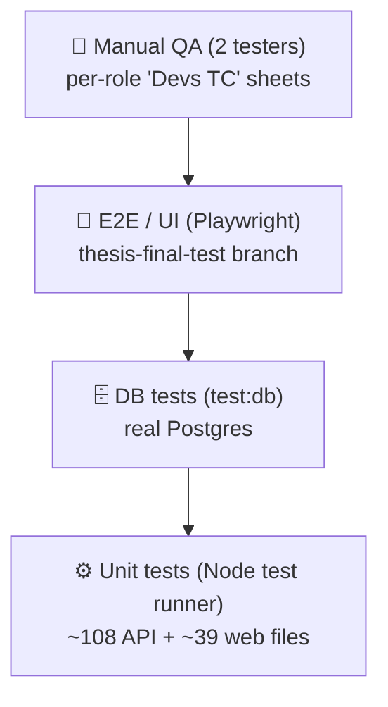

# Testing Strategy

> [!summary] 🟢 In simple terms
> Tests are **little robots that use the system and check the answers**. Some test one formula (unit tests), some test the API with a real database, and some click through the website like a person. Humans (two testers) also check every button and record results in a spreadsheet.

## The testing pyramid in EasyConstruct

## ⚙️ Unit tests — the foundation
Pure functions are tested with hand-built inputs (no DB):
- `lifecycle/gates.test.ts`, `progress.test.ts`, **`boundary.test.ts`** (AI can't affect gates)
- `payroll/engine.test.ts`, `payroll-rules.test.ts`, `trace.test.ts`
- `signals/*.test.ts`, `ai-validation/matcher.test.ts`, `requirements/structuring.test.ts`
- `auth/throttle.test.ts`, `session.test.ts`, `http/security-headers.test.ts`, `cors.test.ts`
- **`role-matrix.test.ts`** reads every route's `requiredRoles` and compares with the expected matrix
- Web: `route-access.test.ts`, `sidebar-nav.test.ts`, `status-tone.test.ts`…
Result on 12 Nov: **1,090 API unit tests pass**; web 411/412.

> [!bug] A real lesson (10 Nov)
> On Linux CI only **5 of 111** API test files were running because a glob wasn't quoted. Fix: quote the globs. Always check *how many* tests ran, not just "green".

## 🗄️ DB tests & CI
- `npm run test:db` runs against a real Postgres (CI seeds demo accounts first).
- `ci.yml`: API + web tests, type checks, and an API **type-error baseline** (`refactor-notes/baseline.md`) so the count can only go down.
- `smoke.yml`: every 30 min against the live API.

## 🤖 QA automation (`thesis-final-test`)
Goal: cut ~36 h of two-person manual clicking to a short human review.
| Spec (CSV, source of truth) | Size |
|---|---|
| `01_access_matrix.csv` | pages & actions × 10 roles (Full / View only / Deny) |
| `02_lifecycle_test_cases.csv` | 35 cases, 191 steps |
| `03_role_page_checks.csv` | 901 checks (navigate, content, search/filter, pagination, form validation, read-only, denied…) |
- Playwright, one stored login per role; API permission suite; UI role suite; lifecycle suite with an **independent progress oracle**; click-everything crawler; smoke suite.
- **CSV reporter** with the same columns as the manual sheet (Test Case ID, Objective, …, Status, Remarks, Executed by = *Automated (Playwright)*).
- **Guard:** refuses to run against the production DB host or `easyconstruct.online`.

## Manuscript testing phases (Ch. 4)
Unit → Integration (e.g. Site Personnel attendance reaches HR → payroll) → Alpha → Beta (ORRA office staff) → Field testing.

Related: [[QA Bug Tracking Nov 2026]] · [[Access Control]]
