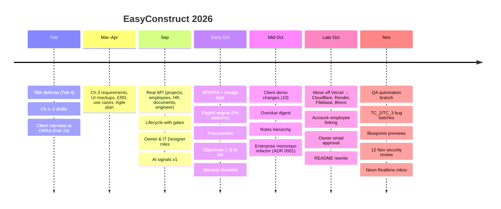

# Development Timeline

> [!summary] 🟢 In simple terms
> The project went from **title proposal (Feb 2026)** → **manuscript & prototype** → **real backend** → **full lifecycle** → **client demo changes** → **enterprise restructure & hosting move** → **QA, security and realtime (Nov 2026)**.

## Milestones by theme
| Theme | Highlights |
|---|---|
| **Foundation** (Sep) | Projects & Employees modules as the reference pattern; custom Refine data provider; Document Oversight; Engineer reports; Requirements |
| **Lifecycle** (late Sep) | Gated Advance, server-owned progress, phase history, write locks, "Waiting on you" → [[Project Lifecycle]] |
| **AI/decision support** (Sep–Oct) | Rule-based signals, proposal validation, cost reference, plan suggestion, impact forecast, reconciliation → [[Decision Support Overview]] |
| **Workforce & money** (Oct) | Payroll engine with SSS/PhilHealth/Pag-IBIG, warnings, trace; procurement; cash flow; expense categories |
| **Client demo** (17 Oct) | Editable doc types, SHA-256 integrity, download/edit audit, stakeholders, multi-recipient RFI with no-login reply, geofence alerts, overdue emails, PM-only approvals, PM reports |
| **Platform** (Oct 19–25) | Modular monorepo, fresh-DB bootstrap, S3 adapter, health checks, cron & backups via GitHub Actions → [[Monorepo Structure]] |
| **Quality & security** (Nov) | [[QA Bug Tracking Nov 2026]] · [[Security Hardening Nov 2026]] · [[Notifications and Realtime]] |

See the detailed latest changes in [[November 2026 Updates]].
